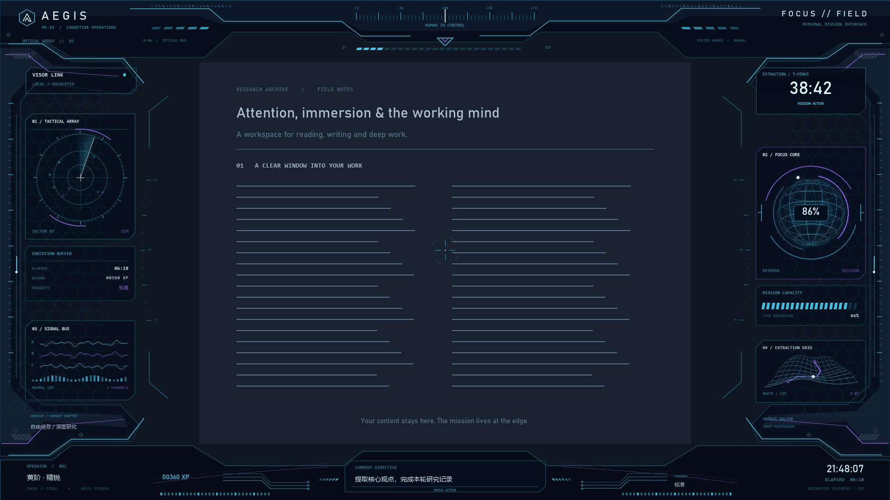
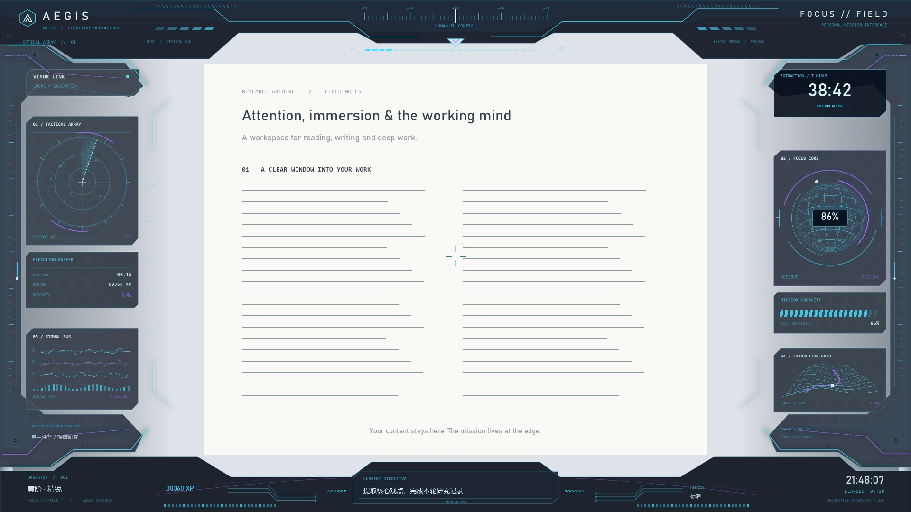
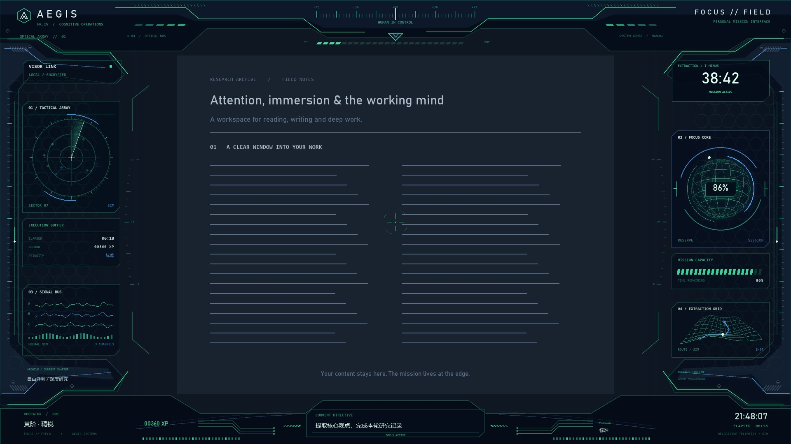
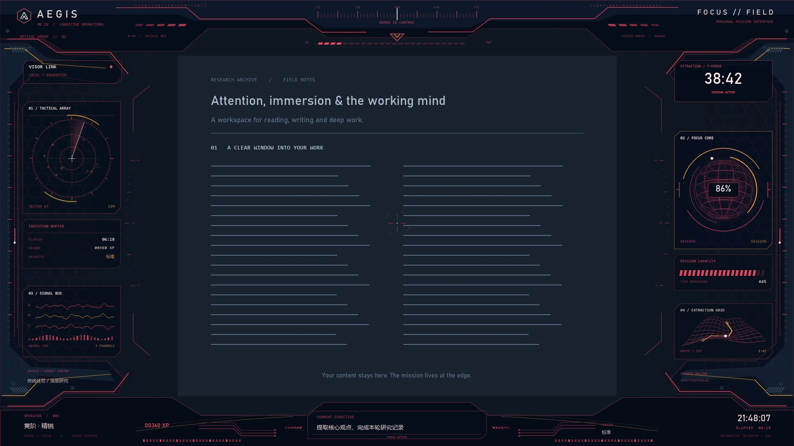
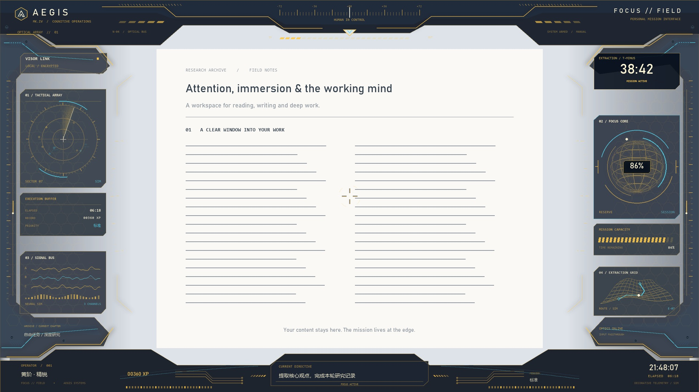

# AEGIS Focus HUD · FOCUS // FIELD

**A Windows desktop heads-up display for immersive focus sessions.**  
*A transparent tactical interface around your workspace—not on top of what you are reading.*

**中文介绍见下方 · [中文说明](#中文说明)**



> **Project status:** Functional personal desktop application; source and generated previews published as a portfolio project. Designed for **Windows 10/11**. The core modules are in Python; Windows-specific overlay behavior must be tested on Windows. It is not an AR headset, a medical ADHD treatment, or a sensor-based tracker.

## Why I built this

While reading papers and working at a computer, I found that a small on-screen crosshair helped me hold my attention. That evolved into an experiment in **attention-supportive interface design**: keep the working area genuinely clear and turn the peripheral display into a sci-fi mission interface. Instead of blocking the document, the HUD frames the work and turns a timed session into a sequence of objectives, progress indicators and optional narrative briefings.

This project combines desktop graphics, Windows windowing APIs, interaction design, state persistence and small procedural visual simulations. It was developed iteratively with AI-assisted coding and hands-on interaction design and testing.

## Preview gallery

| Blue · light | Green · dark |
|:---:|:---:|
|  |  |

| Red · dark | Yellow · light |
|:---:|:---:|
|  |  |

Animated procedural subsystems: [signal bus](previews/signal-bus.webp) · [cave navigation](previews/cave-navigation.webp) · [HUD motion](previews/aegis-motion.webp). These are **program-generated demonstrations**, not recordings of private desktop activity.

## Features

| System | Implementation |
|---|---|
| **True transparent work area** | Per-pixel alpha compositing and a Win32 layered, click-through, non-activating desktop overlay; your document stays visible and interactive |
| **Visual configuration** | Four alert palettes (green / blue / yellow / red), low/medium/high visual density, light/deep peripheral coverage, adjustable brightness |
| **Crosshair module** | Eight reticle styles with adjustable scale; optional, independently configurable subtle animation |
| **Mission timer** | Presets from 15 to 90 minutes, custom 1–240 minutes, pause/resume, manual completion, rest sessions and experience points |
| **Progress & persistence** | Local JSON profile for objectives, history, rank and UI preferences; interrupted sessions can be resumed |
| **Procedural HUD instruments** | Decorative simulated radar, scrolling telemetry-like waveforms, RMS signal bars and a generated 3D cave route map |
| **Narrative mode** | Load local Markdown or JSON mission stories, with Chinese/English interface and parallel story directories; includes an original example storyline |
| **Controls** | Global hotkeys (with conflict fallback), on-the-fly density/color changes, quiet reduced-visual mode and optional soundscape WAV playback |

**Simulation disclosure:** The radar, waveforms and cave map are visual metaphors. They do not inspect your screen, track your eyes, listen to your microphone, or read real-world sensor/location data.

## Quick start (Windows)

Prerequisites: Windows 10/11 desktop, **Python 3.10+**, and Pillow.

```powershell
# Run in the repository directory
py -m pip install -r requirements.txt
py app.py
```

You may also double-click **`启动专注.cmd`** or **`launch.pyw`** on Windows. Choose a focus objective, duration, visual preset, and (optionally) a storyline from the controller window, then start a mission. The HUD overlays the primary display and allows mouse interaction with the app beneath it.

| Shortcut | Action |
|---|---|
| `Ctrl + Alt + H` | Show / hide HUD |
| `Ctrl + Alt + P` | Pause / resume |
| `Ctrl + Alt + Q` | Quit |

If a shortcut conflicts with another application, the app may register an alternative using `Shift`. Check the controller for the active key bindings.

**Limitations:** The primary monitor is targeted; switching monitors and exclusive-fullscreen applications are not supported. Windows fonts (`C:/Windows/Fonts`), `winsound`, and Win32 APIs prevent directly running the GUI on Linux or macOS. Audio tracks are not bundled.

## How it works

```text
app.py / launch.pyw       Tkinter controller, missions, local profile, input
      │
      ├── core.py          Timer, reward/rank logic, story formats, JSON saves
      ├── localization.py  Chinese/English UI and story preferences
      ├── hud_renderer.py  Pillow-based HUD composition, static cache, animation
      │     ├── reticles.py         Eight procedural crosshairs
      │     ├── signal_bus.py       Synthetic waveform / energy samples
      │     └── terrain_scanner.py  Synthetic cave geometry / motion
      └── layered_window.py Windows layered window and transparent click-through
```

The visual aperture in the center uses **zero-alpha pixels**; this is not simply a dark translucent pane. Window styles let mouse input reach the application below the HUD. Persistent state is stored locally in `data/profile.json` (excluded from Git), with no built-in account, cloud sync or telemetry service.

For additional technical notes see [`docs/ARCHITECTURE.md`](docs/ARCHITECTURE.md).

## Storyline extensions

The bundled [`storylines/aegis_demo.json`](storylines/aegis_demo.json) and [`storylines/en/aegis_demo.json`](storylines/en/aegis_demo.json) demonstrate the same original mission in Chinese and English.

- Add custom `.json` or `.md` mission files to `storylines/` (Chinese) or `storylines/en/` (English).
- Keep filenames and chapter order aligned across languages to reuse progress between translations.
- Do not put private diary entries or unlicensed third-party fiction into a public repository.

See [`storylines/README.md`](storylines/README.md) for formats and [`audio/README.md`](audio/README.md) for optional local WAV playback.

## Tests and reproducibility

Run `py -m unittest discover -s tests -v` on **Windows**.

- The public snapshot was checked for Python syntax and source/asset hygiene.
- **10 platform-independent tests passed** during review. An additional Linux run of the full suite reported **16 discovered tests: 10 passed, 1 Windows-overlay test skipped, and 5 failed to execute** because the environment lacks Windows fonts and the `winsound` module. These failures are not evidence that Windows behavior passed or failed.
- Full GUI acceptance (window styles, click-through, hotkeys, audio, and monitor behavior) still requires a Windows run.
- A previous developer-side isolated draw measurement at 2560×1600 was around 27 ms/frame in a particular configuration; this is **not an end-to-end frame-rate guarantee**.

See [`docs/TESTING.md`](docs/TESTING.md).

## Privacy, assets, and rights

- This public source tree **excludes** personal focus logs, local profile files, private goals, cached binaries and external game reference artwork.
- A separate archive contains storyline drafts referencing commercial fictional universes; they are **not distributed here**. Only the original demonstration story is included.
- All preview graphics in this repository are generated by this code and use fictitious sample content.
- **No open-source license has been granted yet.** Public viewing of source code does not imply a grant to copy, modify or redistribute it. Licensing can be decided separately.
- This is an independently built focus/visualization tool; it does not claim affiliation with the owners of referenced science-fiction franchises or games.

---

## 中文说明

**AEGIS Focus HUD / FOCUS // FIELD** 是一个运行在 Windows 桌面上的透明科幻专注辅助工具。它从「在屏幕中央加一个准星帮助阅读」的实际使用需求发展而来：中央尽量保持完整可阅读、可点击，屏幕周边则模拟未来特工头盔的任务界面，让读论文、写作、学习和工作具有更明确的目标与进度感。

**主要功能：** 四种警戒配色、三档视觉密度、可调八种准星、中央逐像素透明与鼠标穿透、任务倒计时与暂停恢复、积分军衔、中文/英文故事任务、程序生成的雷达/通信波形/洞穴导航装饰、快捷键控制以及本地记录保存。雷达等**全部是模拟视觉特效**，不会读取脑电、摄像头、麦克风或地理位置。

**安装运行：** Windows 10/11，Python 3.10+；在项目目录执行 `py -m pip install -r requirements.txt`，然后运行 `py app.py` 或双击 `启动专注.cmd`。需要在 Windows 上运行完整测试 `py -m unittest discover -s tests -v`。这里展示的 Linux 测试结果不能替代 Windows 真机验收。

**数据和版权：** 个人专注历史保存在本机 `data/profile.json`，已经通过 `.gitignore` 排除。公开版本没有包含个人数据、外部游戏参考图片，也没有公开根据商业小说电影创作的故事包。仓库当前尚未授权开源许可证，内容可供查看和学习，使用或再分发需先获得许可。
